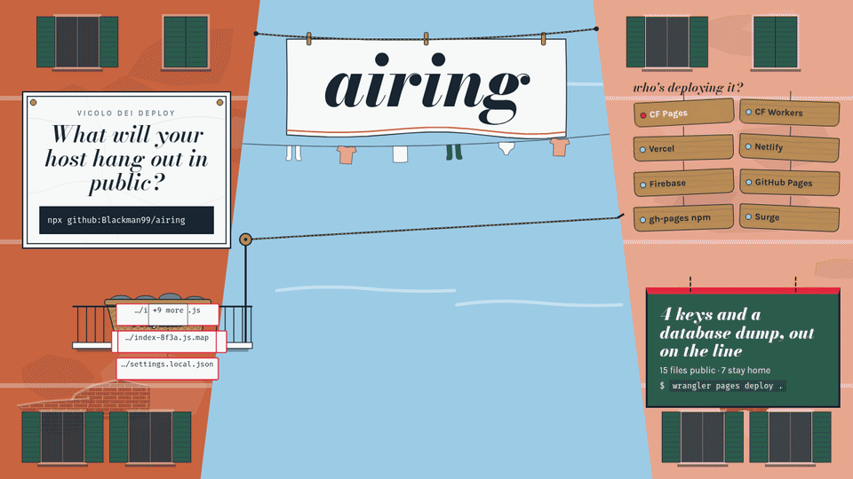

<p align="center"></p>

<h1 align="center">airing</h1>

<p align="center"><b>See what your deploy hangs out in public — before your agent runs it, and after it's live.</b><br>
<a href="https://blackman99.github.io/airing/">site + live demo</a> · <a href="https://blackman99.github.io/airing/docs/">docs</a> · <a href="GOAL.md">goal</a></p>

<p align="center"></p>

## The problem

`wrangler pages deploy .` uploads your `.env`. So does Firebase (dotfiles are in), and Workers assets ship even `.git/`. Vercel skips `.env.local` but not `.env` or `.env.production`. **None of them read your `.gitignore`.** A coding agent that deploys "the folder that works" can publish your keys — [one leaked Gemini key cost $90k this week](https://x.com/JustLingonberry/status/2110824346168238204).

airing reads the folder the way each host's CLI actually does (rules ported from their source and cross-checked against the real libraries in CI) and tells you which secrets would sit at a public URL, plus the one change that keeps them home. Names, sizes and SHA-256 fingerprints only — it never prints a value.

## Try it (10 seconds, nothing to install)

```bash
cd my-site
npx github:Blackman99/airing .
```

```console
$ npx github:Blackman99/airing .
airing · Cloudflare Pages · ./  (package.json scripts.deploy)
  15 files go public · 7 stay home

   LEAK  .env                           314 B    env file — 5 variables, 4 look secret
         GOOGLE_API_KEY     Google Cloud / Gemini  AIza…(39 chars)         sha256:1aa0cc79
                            rotate → https://console.cloud.google.com/apis/credentials
         OPENAI_API_KEY     OpenAI                 sk-proj-…(72 chars)     sha256:41d45bff
         …
   LEAK  backup.sql                     111 B    database dump — your data, downloadable in one request
   RISK  dist/assets/index-8f3a.js.map  135 B    source map with original source
   …

  keep it home: you are deploying the project root — deploy the build output instead: wrangler pages deploy dist

  saved by the host: .git/ (wrangler IGNORE_LIST "**/.git")

✗ 2 leaks would be public. nothing was uploaded — airing only reads. Fix, then deploy.
```

Exit code `1` means something would leak, `0` means clean, `2` means a usage or I/O error — so it drops straight into scripts.

## Stop the agent before it deploys

**Claude Code** — a `PreToolUse` hook that denies a leaking `wrangler` / `vercel` / `netlify` / `firebase` / `gh-pages` command and hands the agent the fix:

```bash
npm i -g https://github.com/Blackman99/airing/releases/latest/download/airing.tgz     # once, so the hook starts in ms
```

```jsonc
// .claude/settings.json
{ "hooks": { "PreToolUse": [{ "matcher": "Bash", "hooks": [{ "type": "command", "command": "airing hook" }] }] } }
```

**Any agent or human** — put `guard --` in front of the deploy; it runs only if nothing would leak:

```bash
airing guard -- npx wrangler pages deploy dist
```

## Check what is already public

```bash
airing probe https://my-site.pages.dev
airing probe https://blackman99.github.io/airing/leaky-demo/   # our deliberately leaky page
```

~40 well-known paths (`/.env*`, `/.git/config`, keys, dumps, agent settings) plus the source maps of the page's own scripts, soft-404 aware so an SPA catch-all never counts. Only probe sites you own; if it finds a key, rotate it first.

## In CI, and over MCP

```yaml
# after your build step
- uses: Blackman99/airing@v0
  with:
    path: .
    probe-url: https://my-site.pages.dev   # optional, after deploy
```

Outputs `leaks`, `risks`, `json`; findings are annotated on the files and written to the job summary. `fail-on: leak | risk | never`.

```json
{ "mcpServers": { "airing": { "command": "npx", "args": ["-y", "github:Blackman99/airing", "mcp"] } } }
```

Read-only tools: `scan_deploy`, `probe_url`, `host_rules`.

## What each host publishes by default

| host | `.env` | `.git/` | `*.map` | reads `.gitignore`? | how to keep files home |
|---|---|---|---|---|---|
| Cloudflare Pages (`wrangler pages deploy`) | **public** | home | **public** | no | deploy the build dir — no ignore file for direct uploads |
| Cloudflare Workers assets | **public** | **public** | **public** | no | `.assetsignore` |
| Vercel (static) | **public** | home | **public** | no | `.vercelignore` |
| Netlify | home | home | **public** | no | keep them out of the publish dir |
| Firebase Hosting | **public** | **public** | **public** | no | `hosting.ignore` in firebase.json |
| GitHub Pages (Actions) | home | home | **public** | no | don't set `include-hidden-files: true` |
| gh-pages (npm) | home | home | **public** | no | don't pass `--dotfiles` |

`airing hosts` prints these rules with links to the upstream source each one is ported from.

## Install

airing is **not on the npm registry yet** (so `npx airing` won't find it). Run it from GitHub, or install the release tarball — it has no runtime dependencies and `dist/` is committed, so nothing builds on install. (Use the tarball for a global install: npm 11's `npm i -g github:…` links a temp clone and leaves a dead `airing` command.)

```bash
npx github:Blackman99/airing .        # one-off, nothing installed
npm i -g https://github.com/Blackman99/airing/releases/latest/download/airing.tgz   # the `airing` command (latest release)
npm i -g https://github.com/Blackman99/airing/releases/download/v0.1.0/airing-0.1.0.tgz   # pinned
```

Node 18.17+. Full reference, configuration and FAQ: [docs](https://blackman99.github.io/airing/docs/).

MIT · [goal](GOAL.md) · [contributing](CONTRIBUTING.md) · [roadmap](ROADMAP.md)
